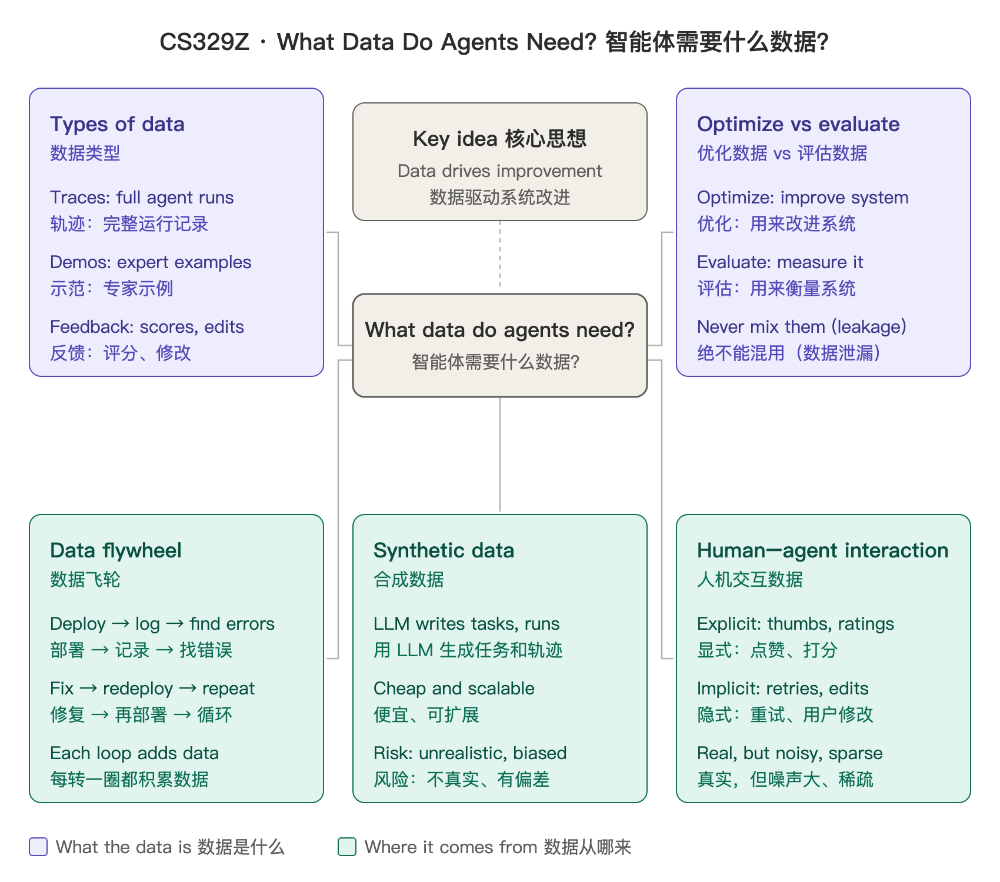

# CS329Z Notes 课程笔记

Bilingual (English / 中文) study notes and mind maps for Stanford CS329Z: Engineering AI Agents, Fall 2026.
斯坦福 CS329Z（Engineering AI Agents）2026 秋季学期的中英双语学习笔记和思维导图。

## Wed Oct 28: What Data Do Agents Need? 智能体需要什么数据？

- **Types of data 数据类型**: traces, demonstrations, feedback / 轨迹、示范、反馈
- **Optimize vs evaluate 优化 vs 评估**: keep training and eval data separate to avoid leakage / 训练数据和评估数据分开，避免泄漏
- **Data flywheel 数据飞轮**: deploy → log → find errors → fix → redeploy / 部署 → 记录 → 找错误 → 修复 → 再部署
- **Synthetic data 合成数据**: cheap and scalable, but can be unrealistic or biased / 便宜、可扩展，但可能不真实或有偏差
- **Human–agent interaction 人机交互数据**: explicit (ratings) and implicit (retries, edits) signals / 显式信号（打分）和隐式信号（重试、修改）

Sources 来源: [CS329Z course schedule](https://cs329z.stanford.edu/) · Shankar, "Data Flywheels for LLM Applications" (2024)

These are my personal notes, built from the syllabus and readings. They are not official course material.
这是我根据课程大纲和阅读材料整理的个人笔记，不是官方课程资料。

Files 文件: `mindmap.png` (image 图片), `mindmap.svg` (vector 矢量图)
