# CS329Z Notes 课程笔记

Bilingual (English / 中文) mind maps for every lecture of Stanford CS329Z: Engineering AI Agents, Fall 2026. Each map has a one-paragraph TL;DR.
斯坦福 CS329Z（Engineering AI Agents）2026 秋季学期每节课的中英双语思维导图，每张图都附一段 TL;DR 总结。

| # | Date 日期 | Lecture 课程 |
|---|---|---|
| 01 | Sep 23 | [Intro to Agentic Systems 智能体系统导论](#01) |
| 02 | Sep 28 | [LLMs for Builders 面向构建者的 LLM](#02) |
| 03 | Sep 30 | [Retrieval-Augmented Generation 检索增强生成 (RAG)](#03) |
| 04 | Oct 5 | [Tool Use & Function Calling 工具使用与函数调用](#04) |
| 05 | Oct 7 | [Frameworks & Orchestration 框架与编排](#05) |
| 06 | Oct 12 | [Agent Design Patterns & Scaffolds 智能体设计模式与脚手架](#06) |
| 07 | Oct 14 | [Agent Memory Architectures 智能体记忆架构](#07) |
| 08 | Oct 19 | [Multi-Agent Systems 多智能体系统](#08) |
| 09 | Oct 21 | [Optimization 优化](#09) |
| 10 | Oct 26 | [Guest: Terminal-Bench & Harbor 嘉宾讲座：Terminal-Bench 与 Harbor](#10) |
| 11 | Oct 28 | [What Data Do Agents Need? 智能体需要什么数据？](#11) |

## 01 · Sep 23 · Intro to Agentic Systems 智能体系统导论

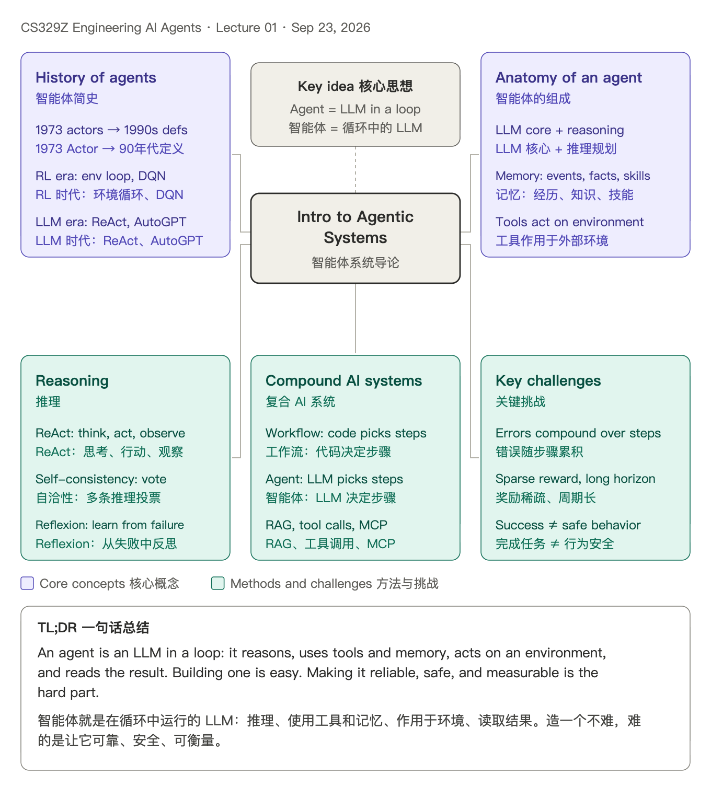

**TL;DR:** An agent is an LLM in a loop: it reasons, uses tools and memory, acts on an environment, and reads the result. Building one is easy. Making it reliable, safe, and measurable is the hard part.

**一句话总结：** 智能体就是在循环中运行的 LLM：推理、使用工具和记忆、作用于环境、读取结果。造一个不难，难的是让它可靠、安全、可衡量。

## 02 · Sep 28 · LLMs for Builders 面向构建者的 LLM

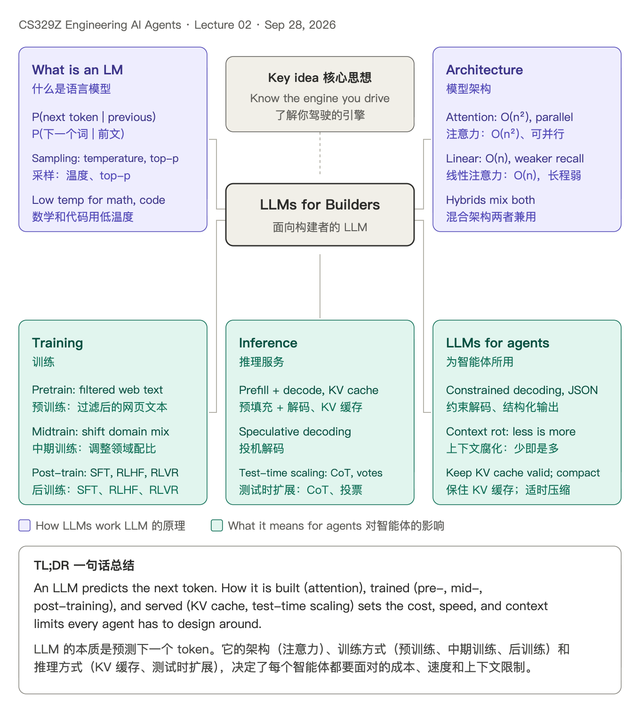

**TL;DR:** An LLM predicts the next token. How it is built (attention), trained (pre-, mid-, post-training), and served (KV cache, test-time scaling) sets the cost, speed, and context limits every agent has to design around.

**一句话总结：** LLM 的本质是预测下一个 token。它的架构（注意力）、训练方式（预训练、中期训练、后训练）和推理方式（KV 缓存、测试时扩展），决定了每个智能体都要面对的成本、速度和上下文限制。

## 03 · Sep 30 · Retrieval-Augmented Generation 检索增强生成 (RAG)

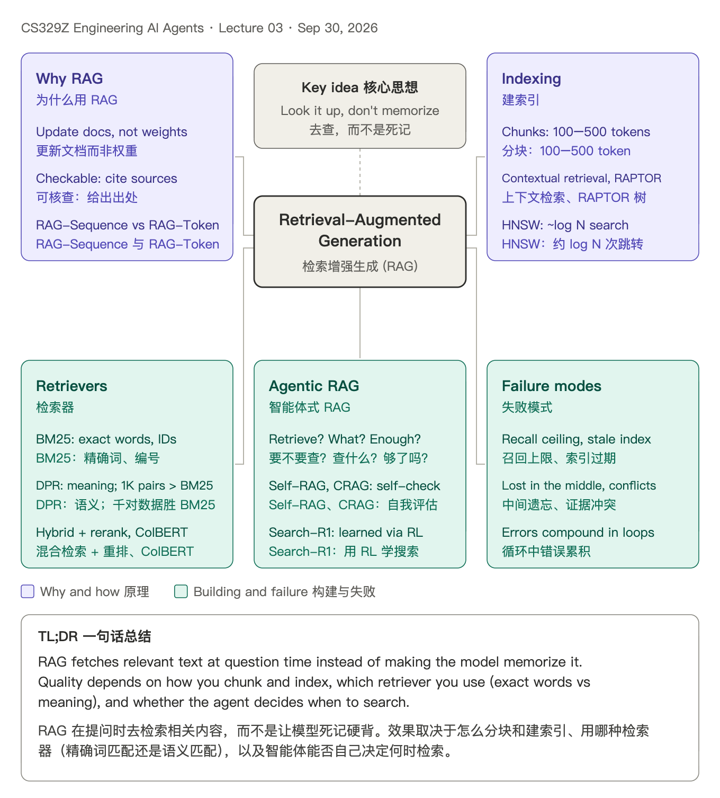

**TL;DR:** RAG fetches relevant text at question time instead of making the model memorize it. Quality depends on how you chunk and index, which retriever you use (exact words vs meaning), and whether the agent decides when to search.

**一句话总结：** RAG 在提问时去检索相关内容，而不是让模型死记硬背。效果取决于怎么分块和建索引、用哪种检索器（精确词匹配还是语义匹配），以及智能体能否自己决定何时检索。

## 04 · Oct 5 · Tool Use & Function Calling 工具使用与函数调用

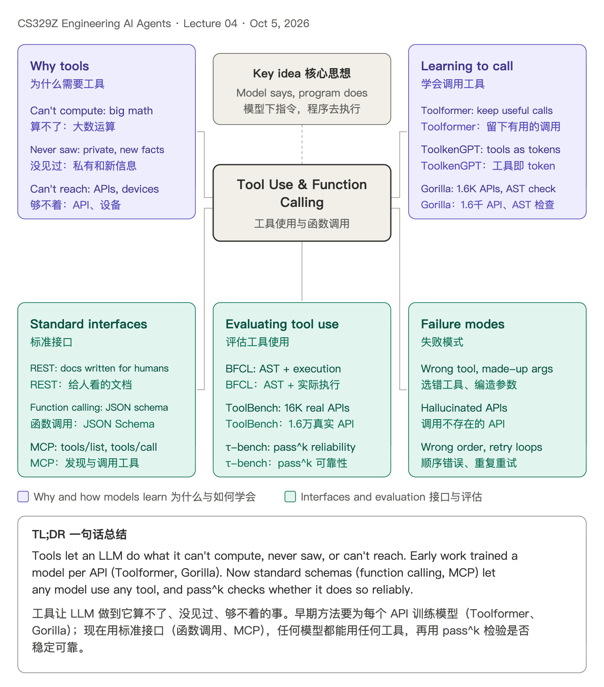

**TL;DR:** Tools let an LLM do what it can't compute, never saw, or can't reach. Early work trained a model per API (Toolformer, Gorilla). Now standard schemas (function calling, MCP) let any model use any tool, and pass^k checks whether it does so reliably.

**一句话总结：** 工具让 LLM 做到它算不了、没见过、够不着的事。早期方法要为每个 API 训练模型（Toolformer、Gorilla）；现在用标准接口（函数调用、MCP），任何模型都能用任何工具，再用 pass^k 检验是否稳定可靠。

## 05 · Oct 7 · Frameworks & Orchestration 框架与编排

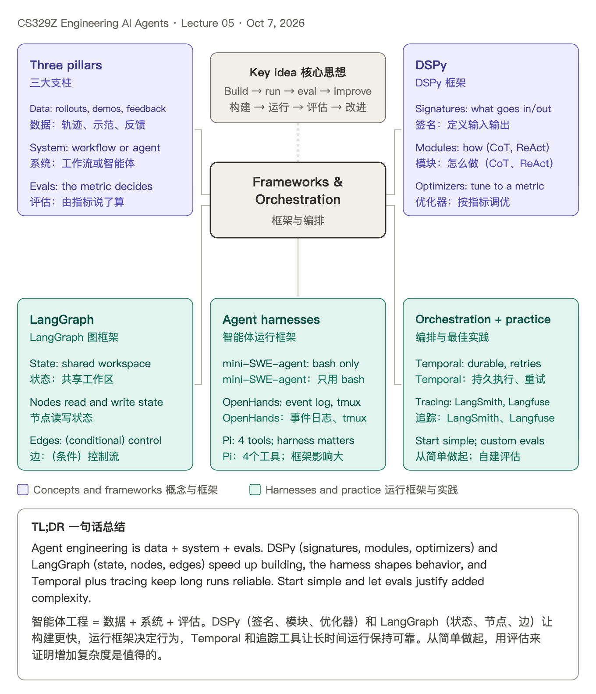

**TL;DR:** Agent engineering is data + system + evals. DSPy (signatures, modules, optimizers) and LangGraph (state, nodes, edges) speed up building, the harness shapes behavior, and Temporal plus tracing keep long runs reliable. Start simple and let evals justify added complexity.

**一句话总结：** 智能体工程 = 数据 + 系统 + 评估。DSPy（签名、模块、优化器）和 LangGraph（状态、节点、边）让构建更快，运行框架决定行为，Temporal 和追踪工具让长时间运行保持可靠。从简单做起，用评估来证明增加复杂度是值得的。

## 06 · Oct 12 · Agent Design Patterns & Scaffolds 智能体设计模式与脚手架

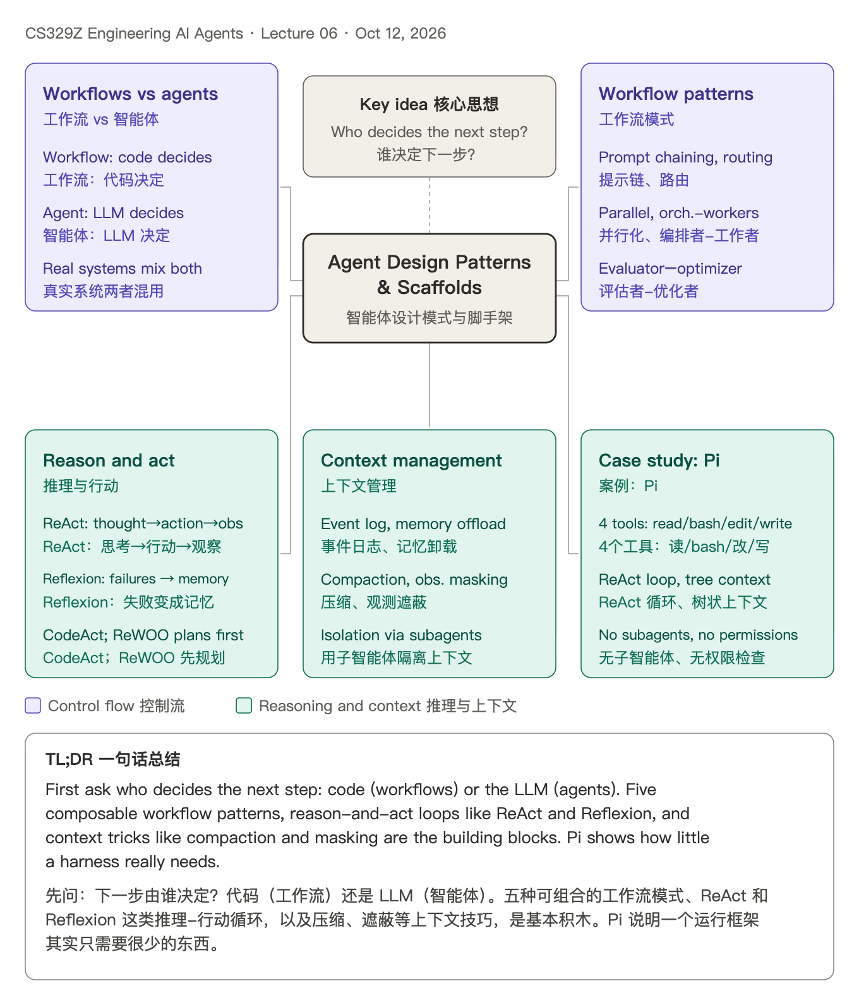

**TL;DR:** First ask who decides the next step: code (workflows) or the LLM (agents). Five composable workflow patterns, reason-and-act loops like ReAct and Reflexion, and context tricks like compaction and masking are the building blocks. Pi shows how little a harness really needs.

**一句话总结：** 先问：下一步由谁决定？代码（工作流）还是 LLM（智能体）。五种可组合的工作流模式、ReAct 和 Reflexion 这类推理-行动循环，以及压缩、遮蔽等上下文技巧，是基本积木。Pi 说明一个运行框架其实只需要很少的东西。

## 07 · Oct 14 · Agent Memory Architectures 智能体记忆架构

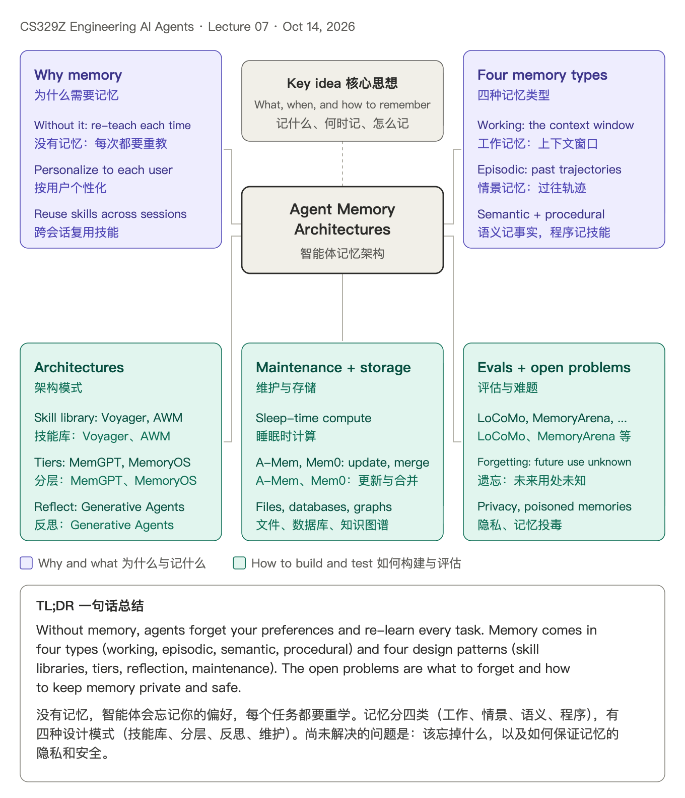

**TL;DR:** Without memory, agents forget your preferences and re-learn every task. Memory comes in four types (working, episodic, semantic, procedural) and four design patterns (skill libraries, tiers, reflection, maintenance). The open problems are what to forget and how to keep memory private and safe.

**一句话总结：** 没有记忆，智能体会忘记你的偏好，每个任务都要重学。记忆分四类（工作、情景、语义、程序），有四种设计模式（技能库、分层、反思、维护）。尚未解决的问题是：该忘掉什么，以及如何保证记忆的隐私和安全。

## 08 · Oct 19 · Multi-Agent Systems 多智能体系统

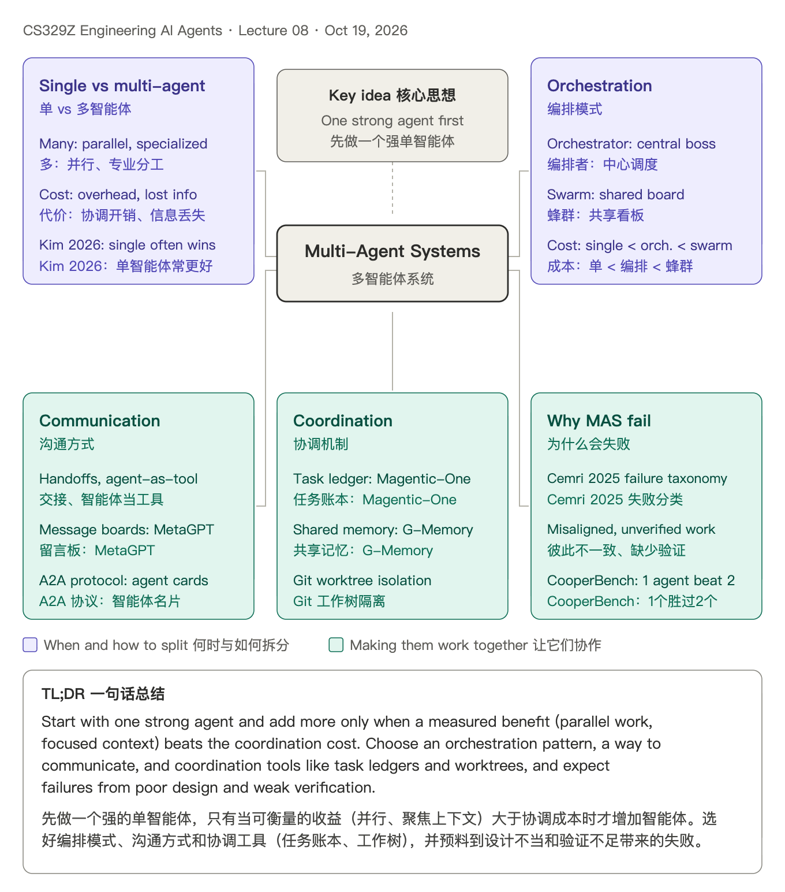

**TL;DR:** Start with one strong agent and add more only when a measured benefit (parallel work, focused context) beats the coordination cost. Choose an orchestration pattern, a way to communicate, and coordination tools like task ledgers and worktrees, and expect failures from poor design and weak verification.

**一句话总结：** 先做一个强的单智能体，只有当可衡量的收益（并行、聚焦上下文）大于协调成本时才增加智能体。选好编排模式、沟通方式和协调工具（任务账本、工作树），并预料到设计不当和验证不足带来的失败。

## 09 · Oct 21 · Optimization 优化

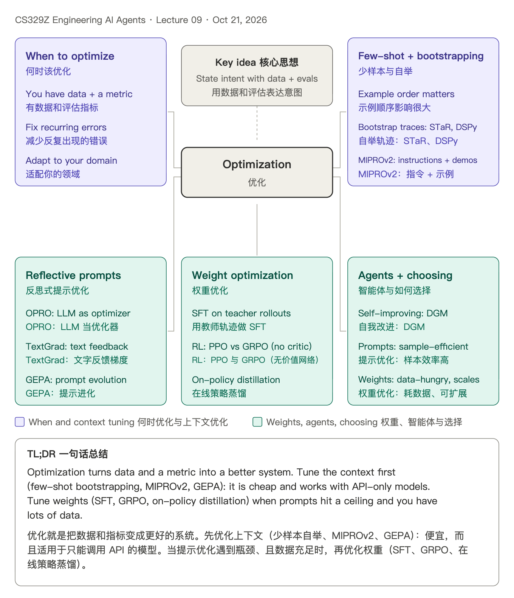

**TL;DR:** Optimization turns data and a metric into a better system. Tune the context first (few-shot bootstrapping, MIPROv2, GEPA): it is cheap and works with API-only models. Tune weights (SFT, GRPO, on-policy distillation) when prompts hit a ceiling and you have lots of data.

**一句话总结：** 优化就是把数据和指标变成更好的系统。先优化上下文（少样本自举、MIPROv2、GEPA）：便宜，而且适用于只能调用 API 的模型。当提示优化遇到瓶颈、且数据充足时，再优化权重（SFT、GRPO、在线策略蒸馏）。

## 10 · Oct 26 · Guest: Terminal-Bench & Harbor 嘉宾讲座：Terminal-Bench 与 Harbor

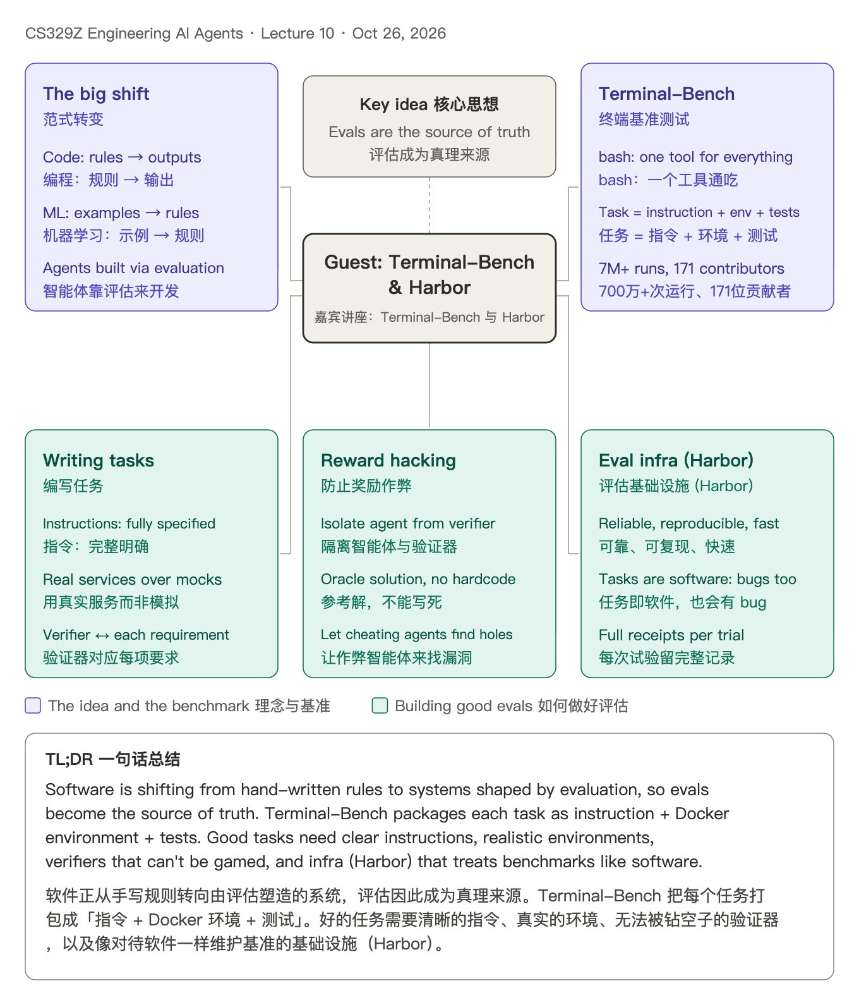

**TL;DR:** Software is shifting from hand-written rules to systems shaped by evaluation, so evals become the source of truth. Terminal-Bench packages each task as instruction + Docker environment + tests. Good tasks need clear instructions, realistic environments, verifiers that can't be gamed, and infra (Harbor) that treats benchmarks like software.

**一句话总结：** 软件正从手写规则转向由评估塑造的系统，评估因此成为真理来源。Terminal-Bench 把每个任务打包成「指令 + Docker 环境 + 测试」。好的任务需要清晰的指令、真实的环境、无法被钻空子的验证器，以及像对待软件一样维护基准的基础设施（Harbor）。

## 11 · Oct 28 · What Data Do Agents Need? 智能体需要什么数据？

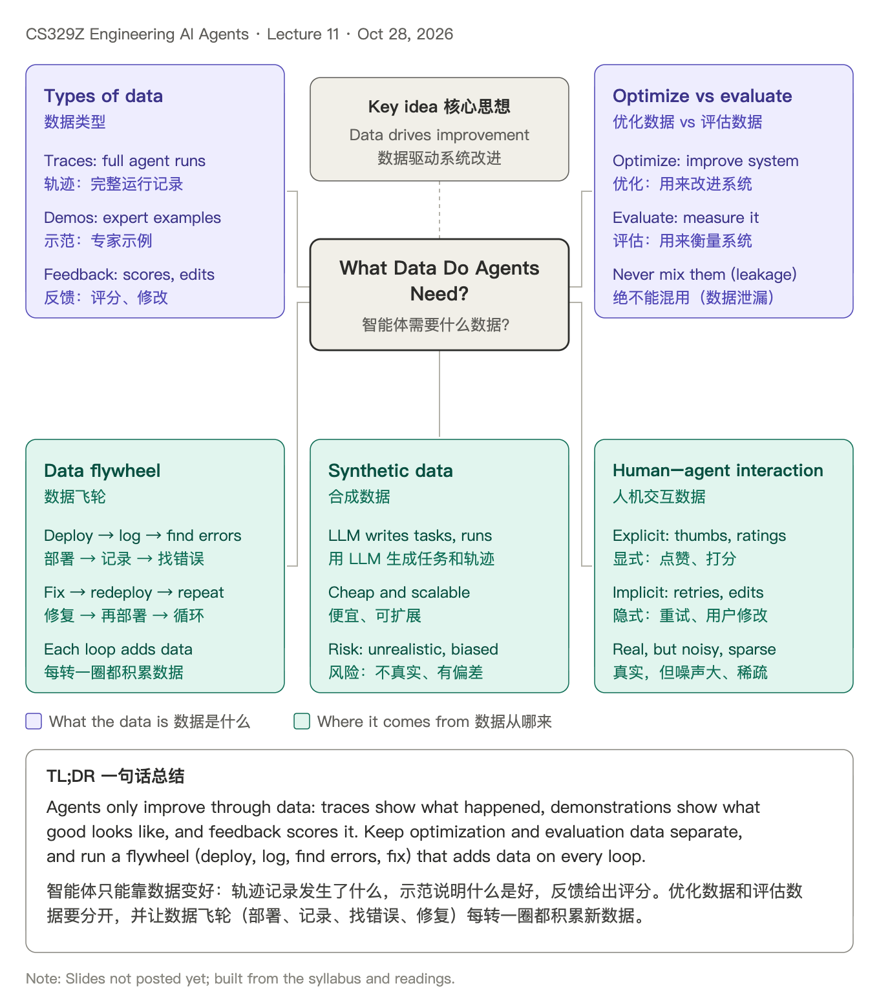

**TL;DR:** Agents only improve through data: traces show what happened, demonstrations show what good looks like, and feedback scores it. Keep optimization and evaluation data separate, and run a flywheel (deploy, log, find errors, fix) that adds data on every loop.

**一句话总结：** 智能体只能靠数据变好：轨迹记录发生了什么，示范说明什么是好，反馈给出评分。优化数据和评估数据要分开，并让数据飞轮（部署、记录、找错误、修复）每转一圈都积累新数据。

*Note: Slides not posted yet; built from the syllabus and readings. 注：课件尚未发布，本图根据课程大纲和阅读材料制作。*

## Sources 来源

- Lecture slides and schedule 课件与课表: [cs329z.stanford.edu](https://cs329z.stanford.edu/)
- Oct 28 reading 阅读材料: Shankar, "Data Flywheels for LLM Applications" (2024)

These are my personal study notes, not official course material. Each map summarizes the posted slides in my own words; errors are mine.
这是我的个人学习笔记，不是官方课程资料。每张图用我自己的话概括已发布的课件，如有错误由我负责。

Each lecture has a `.png` (image 图片) and `.svg` (vector 矢量图) in [`lectures/`](lectures/).
